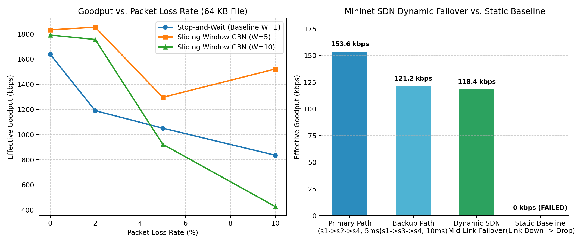

# Reliable UDP File Transfer over SDN

A reliable file transfer system built over raw UDP sockets (`SOCK_DGRAM`) and integrated with a 4-host, 4-switch OpenFlow 1.3 Mininet diamond topology managed by a Ryu SDN controller.

---

## Key Features

- **Custom UDP Reliability Protocol (`packet_protocol.py`):** 15-byte network-order header (`!BIIHI`) with `SYN`, `DATA`, `ACK`, and `FIN` packets, per-packet `CRC32` checksums, and end-to-end `SHA-256` file verification.
- **Stop-and-Wait & Go-Back-N ARQ (`udp_sender.py`):** Supports Stop-and-Wait (`--window 1`) and pipelined Sliding Window Go-Back-N (`--window >1`) with timeout retransmission, Fast Retransmit on duplicate ACKs, simulated wire loss (`--drop-prob`), and JSON metrics export.
- **Multi-Client & Multi-Server Receiver (`udp_receiver.py`):** Spawns a dedicated `ClientSessionWorker` thread per client `(ip, port)` session, drops duplicate/corrupted/out-of-order packets, and deletes files failing size or hash checks.
- **Dynamic SDN Failover (`sdn/controller.py`):** Loop-free OpenFlow 1.3 controller with Priority-`200` Layer-4 UDP rules (ports `5005`/`5006`), `OFPPortStatsRequest` monitoring, automatic primary-to-backup rerouting via `EventOFPPortStatus`, and a `SDN_MODE=static` baseline mode.

---

## Topology & Architecture

```text
                        [ s2 ]  (Primary Path: 5ms hop delay)
                       /      \
  h1 (10.0.0.1) --- [s1]      [s4] --- h2 (10.0.0.2, Server 1 :5005)
  h3 (10.0.0.3) ---/    \    /    \--- h4 (10.0.0.4, Server 2 :5006)
                        [ s3 ]  (Backup Path: 10ms hop delay)
```

- **Clients (Senders):** `h1` (`10.0.0.1`, `s1` port 1) and `h3` (`10.0.0.3`, `s1` port 4)
- **Servers (Receivers):** `h2` (`10.0.0.2`, `s4` port 3) and `h4` (`10.0.0.4`, `s4` port 4)
- **Active Route:** `s1 -> s2 -> s4` (Primary) $\rightarrow$ automatically switches to `s1 -> s3 -> s4` (Backup) on link failure.

---

## Project Structure

```text
udp_reliability_project/
├── packet_protocol.py             # 15-byte header (!BIIHI), CRC32 & SHA-256 helpers
├── udp_sender.py                  # Stop-and-Wait & Go-Back-N UDP sender
├── udp_receiver.py                # Multi-threaded UDP receiver & integrity validator
├── test_transfer.py               # 8 automated end-to-end UDP integration tests
├── benchmark_eval.py              # Baseline vs. proposed benchmark & plot generator
├── results/
│   ├── benchmark_results.csv      # Quantitative metrics (goodput, latency, retries)
│   └── performance_comparison.png # Performance comparison charts
└── sdn/
    ├── controller.py              # Ryu OpenFlow 1.3 failover & telemetry controller
    ├── topology.py                # 4-host, 4-switch Mininet diamond topology
    ├── test_routes.py             # 5 SDN routing & static baseline unit tests
    └── mininet_demo2_scenarios.py # Generates 150 KB test files & command guide
```

---

## Prerequisites (Ubuntu)

Install Mininet, Open vSwitch, and Ryu (in a Python 3.9 virtual environment):

```bash
sudo apt update && sudo apt install -y mininet openvswitch-switch python3-matplotlib

python3.9 -m venv ~/ryu-venv
source ~/ryu-venv/bin/activate
pip install "setuptools<68" wheel
pip install ryu "eventlet==0.30.2" "dnspython==1.16.0"
```

---

## Step 1: Run Automated Tests & Benchmarks

From the project root (`~/udp_reliability_project`):

```bash
# 1. Run all 8 UDP reliability, Go-Back-N, and multi-client/multi-server tests
python3 test_transfer.py

# 2. Run all 5 SDN controller routing & static baseline unit tests
python3 -m unittest -v sdn.test_routes

# 3. Run performance benchmarks and regenerate results/ CSV & PNG graph
python3 benchmark_eval.py

# 4. Generate 150 KB sample payloads (sample_client1.bin & sample_client2.bin)
python3 sdn/mininet_demo2_scenarios.py
```

---

## Step 2: Launch SDN Controller & Mininet

Open **two terminal windows**. Always run `sudo mn -c` **before** starting Ryu (never while Ryu is running).

**Terminal 1 — Ryu OpenFlow 1.3 Controller:**
```bash
sudo mn -c
source ~/ryu-venv/bin/activate
cd ~/udp_reliability_project/sdn
ryu-manager --ofp-tcp-listen-port 6653 controller.py
```

**Terminal 2 — Mininet 4-Host Diamond Topology:**
```bash
cd ~/udp_reliability_project/sdn
sudo python3 topology.py
```

> **Optional Flags:** Use `--loss 5.0` to inject 5% link-layer packet loss, or `--no-delay` to disable the `5ms`/`10ms` link delays.

---

## Step 3: Live Demo Scenarios (Inside `mininet>`)

First verify connectivity across all 4 hosts, inspect OpenFlow rules on `s1`, and start both receiver servers persistently in the background:

```text
mininet> pingall
mininet> sh ovs-ofctl -O OpenFlow13 dump-flows s1
mininet> h2 python3 -u ../udp_receiver.py --ip 0.0.0.0 --port 5005 --out ../received_h2 &
mininet> h4 python3 -u ../udp_receiver.py --ip 0.0.0.0 --port 5006 --out ../received_h4 &
```

### Scenario A — Multi-Client & Multi-Server (`h1 -> h2` and `h3 -> h4`)
Both clients transfer files concurrently to two separate receiver servers:
```text
mininet> h1 python3 -u ../udp_sender.py ../sample_client1.bin --ip 10.0.0.2 --port 5005 --window 5 &
mininet> h3 python3 -u ../udp_sender.py ../sample_client2.bin --ip 10.0.0.4 --port 5006 --window 5
```

### Scenario B — Multiple Clients to a Single Server (`h1` & `h3 -> h2`)
Both clients transfer concurrently to the same server (`h2:5005`), spawning parallel worker threads:
```text
mininet> h1 python3 -u ../udp_sender.py ../sample_client1.bin --ip 10.0.0.2 --port 5005 --window 5 &
mininet> h3 python3 -u ../udp_sender.py ../sample_client2.bin --ip 10.0.0.2 --port 5005 --window 5
```

### Scenario C — Packet Loss Retransmission (Stop-and-Wait vs. Go-Back-N)
Compare Stop-and-Wait (`--window 1`) against Sliding Window Go-Back-N (`--window 5`) under 5% packet loss:
```text
mininet> h1 python3 -u ../udp_sender.py ../sample_client1.bin --ip 10.0.0.2 --port 5005 --window 1 --drop-prob 0.05
mininet> h1 python3 -u ../udp_sender.py ../sample_client1.bin --ip 10.0.0.2 --port 5005 --window 5 --drop-prob 0.05
```

### Scenario D — Mid-Transfer Link Failure & Automatic SDN Rerouting
Cut the primary link (`s1 <-> s2`) during an active transfer, inspect the rerouted flow rules (`s1-eth3`), and restore the link:
```text
mininet> h1 python3 -u ../udp_sender.py ../sample_client1.bin --ip 10.0.0.2 --port 5005 --window 5 &
mininet> link s1 s2 down
mininet> sh ovs-ofctl -O OpenFlow13 dump-flows s1
mininet> link s1 s2 up
```

### Scenario E — Static Baseline Comparison (No Automatic Failover)
Restart Terminal 1 in static mode, launch `topology.py` in Terminal 2, and run `link s1 s2 down` mid-transfer to observe the transfer stall at `0 kbps`:
```bash
SDN_MODE=static ryu-manager --ofp-tcp-listen-port 6653 controller.py
```

---

## Performance Evaluation

Generated via `python3 benchmark_eval.py` (raw metrics in `results/benchmark_results.csv`):



---

## Clean Shutdown

Exit Mininet in Terminal 2, clean up virtual interfaces, and press `Ctrl + C` in Terminal 1 to stop Ryu:

```text
mininet> exit
```
```bash
sudo mn -c
```